# 32-bit RISC-V Processor: Single-Cycle and 5-Stage Pipelined

A 32-bit RV32I processor implemented in Verilog in two versions: a single-cycle baseline and a 5-stage pipelined design with data forwarding and hazard handling. The project covers RTL design, simulation, functional verification, regression automation, mutation testing, synthesis, and static timing analysis using Xilinx Vivado.

## Results at a Glance

| Metric | Single-Cycle | 5-Stage Pipelined |
|---|---:|---:|
| WNS @ 10 ns (post-synthesis) | -0.232 ns | +0.501 ns |
| Estimated Fmax* | ~97.7 MHz | ~105.3 MHz |
| Meets 10 ns timing constraint | No | Yes |

\*Estimated Fmax = `1 / (clock period − WNS)`. These are post-synthesis estimates, not post-implementation results. The timing methodology and its limitations are described in [Synthesis and Timing](#synthesis-and-timing).

## Contents

- [Architecture](#architecture)
- [Design Overview](#design-overview)
- [Supported ISA](#supported-isa)
- [Hazard Handling](#hazard-handling)
- [Verification](#verification)
- [Synthesis and Timing](#synthesis-and-timing)
- [RTL Timing Optimization](#rtl-timing-optimization)
- [Single-Cycle vs. Pipelined](#single-cycle-vs-pipelined)
- [Limitations and Future Work](#limitations-and-future-work)
- [Repository Structure](#repository-structure)
- [Getting Started](#getting-started)
- [Verification Customization](#verification-customization)
- [Memory Initialization Warnings](#memory-initialization-warnings)
- [Running the Directed Simulation](#running-the-directed-simulation)
- [Tools](#tools)
- [License](#license)

## Architecture

### Single-Cycle

Each instruction is fetched, decoded, executed, memory-accessed, and written back in one clock cycle.

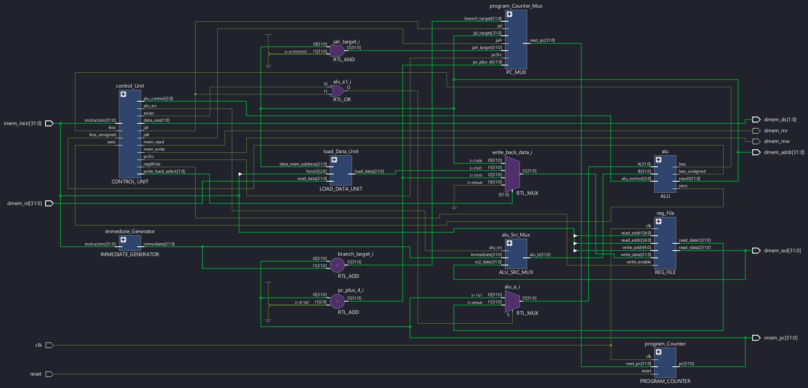

High-resolution version: [architecture_schematic_high_res.pdf](docs/single_cycle/architecture_schematic_high_res.pdf)

### 5-Stage Pipeline

The single-cycle design was extended into an `IF → ID → EX → MEM → WB` pipeline with `IF/ID`, `ID/EX`, `EX/MEM`, and `MEM/WB` pipeline registers, forwarding, hazard detection, and a dedicated branch comparator in EX.

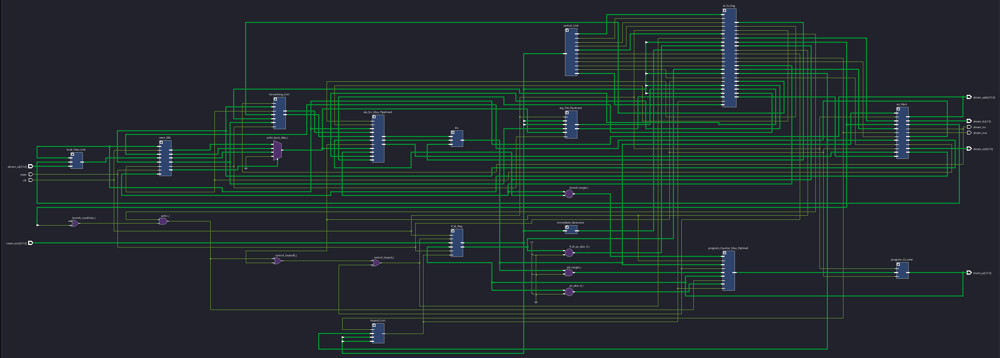

High-resolution version: [architecture_schematic_high_res.pdf](docs/pipelined/architecture_schematic_high_res.pdf)

## Design Overview

Both implementations use the following main blocks:

- **Control unit:** Decodes opcode and function fields into ALU, memory, write-back, and jump control signals.
- **ALU:** Supports arithmetic, logic, shifts, set-less-than operations, and LUI pass-through.
- **Register file:** 32 × 32-bit registers, two read ports, x0 hardwired to zero, and write-through bypass.
- **Immediate generator:** Generates and sign-extends I, S, B, U, and J immediates.
- **PC logic:** Program-counter register and next-PC selection for sequential execution, branches, JAL, and JALR.
- **Load/store interface:** Supports byte, halfword, and word stores with byte-lane merging, and sign-extended or zero-extended loads.

The pipelined implementation additionally includes four pipeline registers, a forwarding unit, and a hazard unit.

## Supported ISA

The processor implements 37 instructions from the RV32I base integer instruction set.

| Type | Instructions |
|---|---|
| R-type | ADD, SUB, AND, OR, XOR, SLL, SRL, SRA, SLT, SLTU |
| I-type (ALU) | ADDI, ANDI, ORI, XORI, SLTI, SLTIU, SLLI, SRLI, SRAI |
| I-type (load) | LB, LH, LW, LBU, LHU |
| I-type (jump) | JALR |
| S-type | SB, SH, SW |
| B-type | BEQ, BNE, BLT, BGE, BLTU, BGEU |
| U-type | LUI, AUIPC |
| J-type | JAL |

**Not implemented:** `FENCE`, `ECALL`, `EBREAK`, CSRs, illegal-instruction traps, misaligned accesses, and the M extension. An earlier pipelined version included `MUL`, which was subsequently removed during timing optimization.

## Hazard Handling

| Hazard | Mechanism | Cost |
|---|---|---:|
| Data dependency (producer in EX/MEM or MEM/WB) | Forwarding into ALU operand muxes | 0 cycles |
| Data dependency (producer in WB, consumer in ID) | Register-file write-through | 0 cycles |
| Load-use | Stall PC and `IF/ID`; insert a bubble into `ID/EX` | 1 cycle |
| Control (taken branch, JAL, JALR) | Resolve in EX; flush `IF/ID` and `ID/EX` | 2 cycles |

Branches use static not-taken prediction.

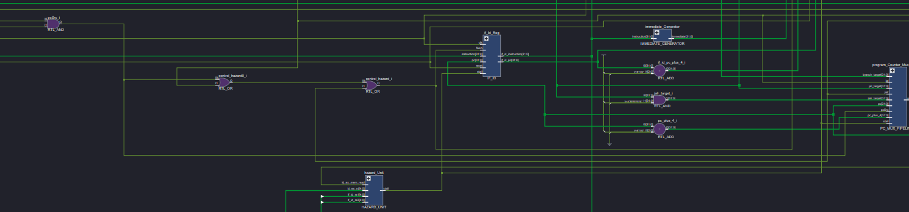

## Verification

Verification evolved from manually driven instruction testing to a self-checking SystemVerilog environment with automated regression and mutation testing. The verification approach is guided by the principles below. The current detailed evidence is for the single-cycle core; the pipelined core is not yet claimed to have completed the same verification standard.

### Verification principles

1. **Independent reference model.** A software model decodes raw instruction words independently of the RTL and the stimulus encoder. This reduces the risk that the same implementation mistake is shared by the design and its checker.
2. **Architectural checking, instruction by instruction.** The checker compares expected and actual architectural behaviour at each instruction, rather than relying only on final register values. A mismatch should identify the failing instruction and relevant expected/actual values.
3. **Legal stimulus by construction.** The generator creates programs that obey the implemented core's supported instruction and memory-access assumptions. The design does not currently implement traps for unsupported or illegal encodings.
4. **Directed and constrained-random stimulus.** Random values are biased toward useful corner cases and are combined with directed sequences for boundary values, branches, jumps, and memory byte lanes.
5. **Coverage is a pass criterion.** A run must exercise required instruction classes and targeted scenarios; a PASS without the required coverage is not sufficient.
6. **Reproducibility.** Runs are controlled by instruction-count and seed settings. A failing seed should be replayable, with trace output enabled when needed.
7. **Automated regression.** A Tcl script compiles, elaborates, runs, evaluates, and archives each test independently, then reports an overall result.
8. **Test the testbench.** Mutation testing deliberately injects faults into the CPU RTL and checks whether the verification environment detects them.

### Stage 1: Directed Verilog testbenches

The initial testbenches used manually supplied instruction sequences loaded into instruction memory. Simulation waveforms and `$display` output were inspected to evaluate processor behaviour.

These tests covered ALU operations, load/store instructions, branches, jumps and, for the pipelined implementation, forwarding, load-use, and control-hazard scenarios. The original simulation environments are retained in `simulation/single_cycle/` and `simulation/pipelined/`.

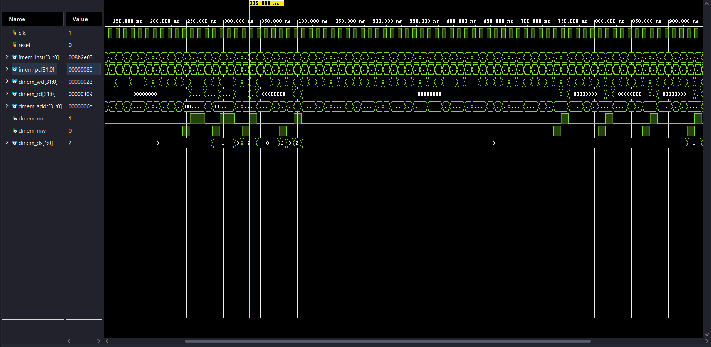

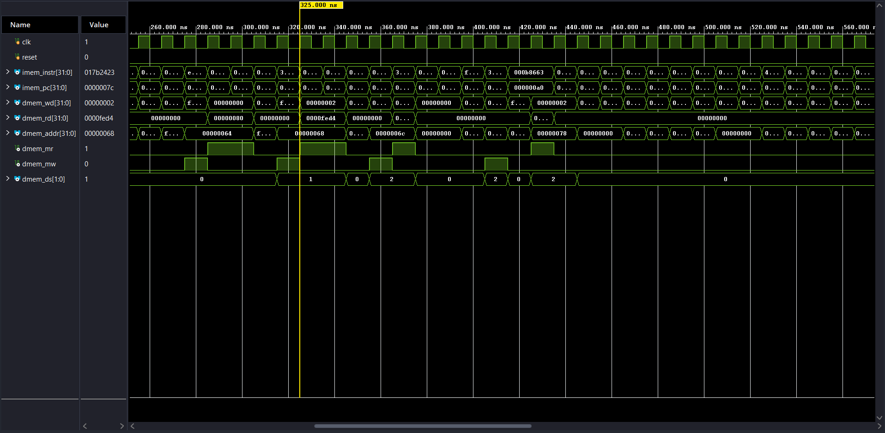

The main limitation of this approach was that checking depended on the scenarios selected and the waveforms manually inspected.

### Stage 2: Self-checking SystemVerilog environment

A dedicated SystemVerilog testbench was developed for the single-cycle processor. It automatically generates stimulus and checks processor behaviour.

The environment uses an assertion-based and UVM-inspired, transaction-oriented structure. **It is not a full UVM implementation.**

Its main elements include:

- **Transaction and instruction generation:** Generates legal RV32I instruction sequences, including directed corner cases and randomized stimulus.
- **Independent reference model:** Decodes instruction words and calculates expected architectural results independently of the RTL.
- **Scoreboard/checker:** Compares DUT behaviour with the reference model and reports mismatches.
- **Assertions:** Checks selected design properties and expected behaviour.
- **Coverage checks:** Audits required instructions, branch outcomes, memory operations, and corner cases.
- **Targeted stimulus:** Exercises corner values, byte and halfword lanes, branch and jump behaviour, and boundary conditions.

The single-cycle testbench is `cpu_tb.sv` in the Vivado project's simulation sources. The older manually driven Verilog testbench is retained separately as `vivado/single_cycle/cpu_tb.v`.

The verification-standard document describes the single-cycle environment in more detail. Its checker compares, before the active clock edge, the fetched PC and instruction, register-write intent and destination, and data-bus information (strobes, address, size, and store data). After the edge, it checks the architectural register state and the memory word just stored. At the halt loop it compares the complete data memory and evaluates coverage.

The program builder includes register initialization, seeded data memory, instruction and branch coverage sequences, loop/backward-branch macros, byte-lane sweeps, corner-value operand pairs, long-range branch and jump cases, a weighted random body, and a halt sequence.

### Stage 3: Scripted regression

A Tcl script automates compilation, elaboration, and execution of the SystemVerilog testbench using the Vivado simulation flow:

- `xvlog -sv` compiles the SystemVerilog sources.
- `xelab` elaborates the simulation.
- `xsim` runs the testbench in batch mode.

The checked-in regression configuration described by the current run log uses five instruction counts (100, 500, 1,000, 2,000, and 5,000) and three seeds (1, 2, and 3), for 15 runs.

Script: `vivado/single_cycle/scripts/run_regression.tcl`

#### Recorded regression results

| Random instructions | Seeds | Result |
|---:|---|---|
| 100 | 1, 2, 3 | PASS |
| 500 | 1, 2, 3 | PASS |
| 1,000 | 1, 2, 3 | PASS |
| 2,000 | 1, 2, 3 | PASS |
| 5,000 | 1, 2, 3 | PASS |
| **Total** | **15 runs** | **15/15 PASS** |

All 15 recorded runs passed. The seed-diversity check confirmed that all three seeds generated different programs at every instruction count. The runs performed **1,895,564 scoreboard/checker checks** in total.

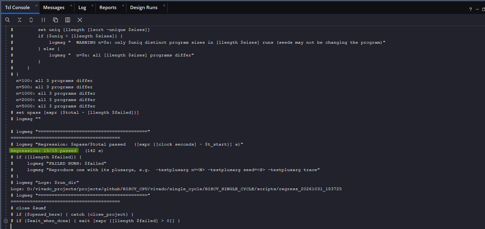

**Regression configuration and evidence:** The regression results reported in this README reflect the 3-seed, 15-run configuration, with 15/15 tests passing. These results are supported by the latest simulation run and evidence currently documented for this repository. Update this section if a subsequent regression uses a different configuration or produces new verified results.

### Stage 4: Mutation testing

The mutation script evaluates the fault-detection capability of the verification environment. It temporarily applies deliberate faults to the CPU RTL, runs the same SystemVerilog testbench against each modified design, records whether the testbench detects the fault, and restores the original RTL. A post-restoration sanity run checks that the original design still passes.

The recorded mutation suite contains 40 cases:

- 37 non-equivalent mutations expected to be detected.
- 3 mutations classified as equivalent because they do not change externally observable behaviour in this design.

#### Recorded mutation results

| Result | Count |
|---|---:|
| Mutants killed | 37 |
| Equivalent mutants that survived | 3 |
| Unexpected survivors | 0 |
| Invalid / not applied / errors | 0 |
| **Mutation score** | **37/37 = 100%** |

The three equivalent mutants were:

- **R02:** A redundant x0 read mask.
- **D04:** Read gating whose output is only consumed by loads.
- **C05:** A JAL control change made redundant by the CPU's independent JAL logic.

They are reported separately and are not counted as non-equivalent mutants in the mutation-score denominator. The post-restoration sanity run passed.

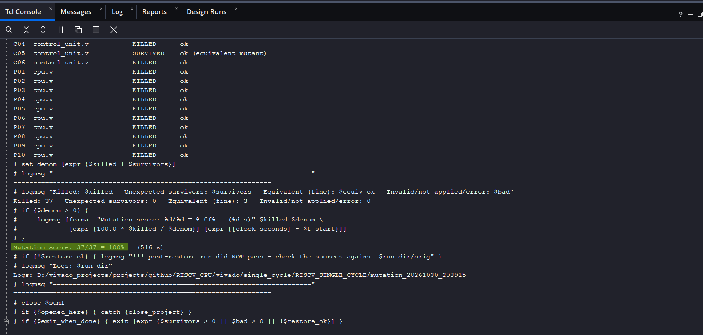

A 100% mutation score applies only to the 37 non-equivalent mutations in this suite. It does not mean that every possible design fault or every RV32I behaviour has been exhaustively verified.

The mutation script checks that each mutation pattern matches exactly once, restores the original source, and verifies the restoration byte for byte after each mutant. It also requires a clean baseline run before mutation testing. Treat the script as source-modifying: run it only with a clean backup or committed copy of the RTL, and do not interrupt it while a mutation is applied.

### Verification status and remaining work

- **Single-cycle core:** The current recorded evidence is a 15-run regression with all runs passing, seed-diversity checks passing, 1,895,564 checker/scoreboard checks, and a 37/37 mutation score across non-equivalent mutants. The original RTL passed the post-mutation sanity run.
- **Pipelined core:** The earlier directed simulation environment is available, but the full self-checking verification standard is still to be completed and validated for the pipelined implementation.

The intended pipelined verification extension reuses the same architectural reference model and program classes, but changes how instructions are compared because instructions overlap in the pipeline:

- **Retirement/commit comparison:** Prefer a retire-stream comparison against the model's expected instruction trace. If a retirement probe is unavailable, use black-box checks of the store stream, final registers, and final memory, while recognizing that this is weaker evidence.
- **Store-stream checking:** Every store reaching the data bus must match the model's store sequence and order. Unexpected or duplicated stores can reveal wrong-path or duplicated execution.
- **Hazard coverage gates:** Exercise RAW dependencies at distances 1–3 on both operands, load-use dependencies at distances 1–3, store-data and branch-operand dependencies, JALR base dependencies, write-after-write sequences, x0 behaviour after an attempted x0 write, and wrong-path windows containing a store, load, and ALU write after taken control transfers.
- **Hazard-dense random stimulus:** Use a deliberately small register pool so that back-to-back dependencies occur frequently.
- **Progress watchdog:** Detect deadlock or runaway stalling.
- **Pipeline-specific mutations:** Target forwarding, stall, flush, and bypass logic in addition to shared datapath modules.

### Definition of done

The verification-standard document defines the following intended completion criteria:

1. Regression passes across the full size/seed matrix with no required coverage holes.
2. The mutation score is 100% of killable mutants, with every surviving mutant explained as equivalent.
3. A set of independently assembled programs matches a reference result.
4. Known limits are either addressed or explicitly documented.
5. Synthesis, timing analysis, and a board run succeed.

These are project verification goals, not a claim that every item has already been completed.

## Synthesis and Timing

Both designs were synthesized in Xilinx Vivado for the Basys 3 FPGA (Artix-7 `xc7a35tcpg236-1`) under a 10 ns clock constraint.

> **These are post-synthesis results, not post-place-and-route results.** Synthesis uses estimated net delays, so implementation results may differ.

| Metric | Single-Cycle | 5-Stage Pipelined |
|---|---:|---:|
| LUTs | 842 | 913 |
| Flip-flops | 32 | 504 |
| Distributed RAM LUTs | 48 | 48 |
| WNS (setup) | -0.232 ns | +0.501 ns |
| TNS (setup) | -4.821 ns | 0 ns |
| Failing setup endpoints | 54 / 100 | 0 |
| Estimated Fmax* | ~97.7 MHz | ~105.3 MHz |

\*Calculated as `1 / (clock period − WNS)`.

**Methodology:** The `CPU` module was synthesized out-of-context, with instruction and data memories outside the module and no input or output delay constraints. The results therefore cover the internal register-to-register paths of the core. In particular, the single-cycle result does not include instruction-fetch or data-memory access time, so it understates a real single-cycle cycle time. Both designs used the same FPGA part, clock constraint, and synthesis flow, making the comparison like-for-like within this methodology.

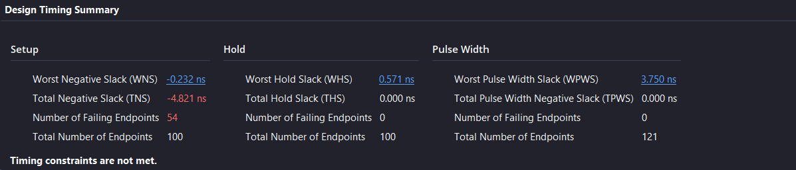

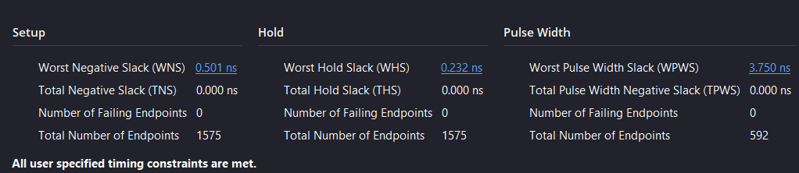

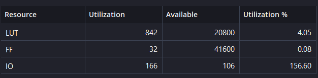

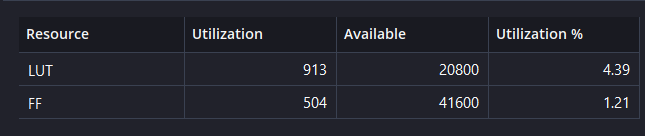

## RTL Timing Optimization

The pipelined design initially failed timing. The following RTL changes improved post-synthesis WNS:

| Optimization step | WNS |
|---|---:|
| Original pipelined CPU with MUL | -8.901 ns |
| Removed MUL | -3.300 ns |
| Added a separate branch comparator | -0.169 ns |
| Restructured comparator selection (select on `funct3[2:1]`, invert with `funct3[0]`) | +0.501 ns |

### Dedicated branch comparator

Branch decisions were separated from the main ALU. A dedicated comparator in EX computes equality, signed less-than, and unsigned less-than, selects the comparison using `funct3[2:1]`, and inverts the result using `funct3[0]` for BNE, BGE, and BGEU.

```verilog
wire [31:0] cmp_a = alu_a;
wire [31:0] cmp_b = forwarded_rs2;
wire [31:0] cmp_sub_result = cmp_a - cmp_b;

wire eq           = ~|(cmp_a ^ cmp_b);
wire signs_differ = cmp_a[31] ^ cmp_b[31];
wire slt = signs_differ ? cmp_a[31] : cmp_sub_result[31];  // BLT / BGE
wire ult = signs_differ ? cmp_b[31] : cmp_sub_result[31];  // BLTU / BGEU

reg cmp_out;
always @(*) begin
    case (id_ex_funct3[2:1])
        2'b00:   cmp_out = eq;   // BEQ / BNE
        2'b10:   cmp_out = slt;  // BLT / BGE
        2'b11:   cmp_out = ult;  // BLTU / BGEU
        default: cmp_out = 1'b0;
    endcase
end

wire branch_condition = cmp_out ^ id_ex_funct3[0];
wire pcSrc = id_ex_branch && branch_condition;
```

The comparator supports all six conditional branch instructions.

## Single-Cycle vs. Pipelined

- **Timing:** The single-cycle design misses the 10 ns constraint (WNS -0.232 ns, 54 failing endpoints). The pipelined design meets it (WNS +0.501 ns, zero failing endpoints).
- **Estimated Fmax:** ~97.7 MHz for single-cycle and ~105.3 MHz for pipelined, based on the post-synthesis WNS calculation.
- **Flip-flops:** 32 in the single-cycle design compared with 504 in the pipelined design, primarily due to the four pipeline registers.
- **LUTs:** 842 in the single-cycle design and 913 in the pipelined design.
- **Distributed RAM:** 48 LUTs in both implementations.

Fmax is not the same as application performance. Load-use stalls and branch flushes increase the pipelined design's CPI above 1. See [docs/comparison.md](docs/comparison.md) for the side-by-side summary.

## Limitations and Future Work

- Timing results are post-synthesis and core-only, with instruction and data memories excluded from the timed module. Post-implementation timing with memories in the timed loop remains future work.
- `FENCE`, `ECALL`, `EBREAK`, CSRs, illegal-instruction traps, misaligned accesses, and the M extension are not implemented.
- The pipelined design uses static not-taken branch prediction, with a two-cycle penalty for taken branches.
- The single-cycle verification environment is established; extending and validating the full verification environment for the pipelined implementation is ongoing.
- Independent external reference checking (for example, comparing independently assembled programs with a trusted RISC-V reference such as Spike) remains future work.
- A throughput comparison using cycles multiplied by clock period on representative benchmark programs remains future work.
- A complete board-level run and post-implementation timing are not established by the post-synthesis results shown here.

## Repository Structure

The repository root is the `RISCV-32bit-processor/` folder created automatically by `git clone`.

```text
RISCV-32bit-processor/
├── docs/
│   └──             # Architecture diagrams, schematics, timing reports, and documentation
├── simulation/
│   ├── single_cycle/
│   │               # Single-cycle CPU simulation files and test programs
│   └── pipelined/
│                   # Pipelined CPU simulation files and test programs
├── vivado/
│   ├── single_cycle/
│   │   ├── RISCV_SINGLE_CYCLE/
│   │   │   ├── RISCV_SINGLE_CYCLE.xpr
│   │   │   ├── RISCV_SINGLE_CYCLE.srcs/
│   │   │   │       # Project-local RTL and simulation sources used by Vivado
│   │   │   └── scripts/
│   │   │           # Vivado Tcl scripts for simulation and verification
│   │   ├── rtl/
│   │   │           # Standalone reference copies of single-cycle RTL modules
│   │   └── tb/
│   │               # Standalone testbench copies
│   └── pipelined/
│                   # Vivado project for the pipelined CPU
├── README.md
└── .gitignore
```

The Vivado project folder contains the `.xpr` project and its imported source files, including the RTL, SystemVerilog testbench, and memory initialization files. The `scripts/` directory contains the automated regression and mutation Tcl scripts. The screenshots in `docs/` are committed verification evidence; generated Vivado run, cache, and simulation-output directories should generally be excluded from Git.

## Getting Started

### 1. Clone the repository

```bash
git clone https://github.com/arunconnectshere-commits/RISCV-32bit-processor.git
cd RISCV-32bit-processor
```

Git creates the outer `RISCV-32bit-processor/` directory automatically. No additional parent folder is needed in the GitHub repository.

### 2. Open the single-cycle Vivado project

Open this project file in Vivado:

```text
vivado/single_cycle/RISCV_SINGLE_CYCLE/RISCV_SINGLE_CYCLE.xpr
```

Wait for Vivado to finish loading the project before running either Tcl script.

**Note:** The commands below assume Vivado's current working directory is
`vivado/single_cycle/RISCV_SINGLE_CYCLE`, as in the project's normal launch workflow. If the
working directory differs, use the script path relative to that directory.

### 3. Run regression

Open the Vivado Tcl Console and run:

```tcl
source {scripts/run_regression.tcl}
```

The script runs the configured instruction-count and seed matrix, compiles and elaborates the testbench, runs the simulations, and writes a timestamped log directory.

### 4. Run mutation testing

After the regression passes, run:

```tcl
source {scripts/run_mutation.tcl}
```

The mutation script temporarily changes RTL source files to introduce known faults, runs the testbench against each mutant, records the outcome, restores the original source, and performs a post-restoration sanity run.


**Run mutation testing only with a clean backup or committed copy of the original RTL.** The script modifies source files during execution. Do not interrupt it while a mutation is applied; if execution is interrupted, inspect and restore the RTL before continuing.

## Verification Customization

### Increase regression size and seed count

The checked-in regression matrix is a practical starting point, not a limit. You can edit the instruction-count list and seed list in `run_regression.tcl` to:

- Increase the number of random instructions generated per run.
- Add more seeds to explore different randomized programs.
- Add additional instruction-count configurations.
- Run longer tests to exercise more combinations and corner cases.

Larger tests and more seeds increase simulation time. Preserve the original configuration if you want to reproduce the 15-run baseline documented above. If you change the configuration, retain the new logs and update the README with the actual results.

### Extend the mutation suite

You are welcome to modify `run_mutation.tcl` and add new mutation cases to challenge the testbench further. Mutations should represent meaningful functional faults, such as incorrect ALU behaviour, immediate generation, branch decisions, register-file behaviour, forwarding, hazard control, or memory access.

Mutation testing evaluates the **fault-detection capability of the testbench**: the script intentionally damages the CPU RTL and checks whether the testbench catches the resulting incorrect behaviour. It is not simply another way of running the unmodified CPU.

A killed mutant means the testbench detected the injected fault. A surviving non-equivalent mutant may indicate a gap in stimulus, checking, assertions, or reference-model behaviour. Investigate survivors rather than assuming every survivor is a testbench failure; some mutations may be functionally equivalent to the original design.

## Memory Initialization Warnings

When launching behavioural simulation directly from the Vivado GUI, you may see warnings that `sim/data.hex` or `sim/program.hex` cannot be opened. These messages can occur because the GUI simulator's working directory differs from the directory expected by the testbench's relative `$readmemh` paths.

The automated Tcl regression flow has its own simulation setup and completed the recorded regression successfully. A warning from a separate GUI launch does not by itself mean that the regression failed. However, **do not ignore a missing-memory-file warning if you are relying on that GUI simulation's results**: confirm that the memory files were actually loaded and that the simulation used the intended program and data.

## Running the Directed Simulation

The original directed simulation environments can be run using Icarus Verilog. For example, for the pipelined version:

```bash
cd simulation/pipelined
iverilog -g2012 -o cpu_sim *.v
vvp cpu_sim
gtkwave dump.vcd
```

For the single-cycle design, use `simulation/single_cycle/` instead. Memory initialization files use relative paths (for example, `sim/program.hex`), so run the simulator from the directory expected by the relevant testbench.

## Tools

Verilog HDL · SystemVerilog · SystemVerilog Assertions · Tcl · Icarus Verilog · GTKWave · Verilator · Yosys · Xilinx Vivado / XSIM · Git

## License

Released under the [MIT License](LICENSE).
